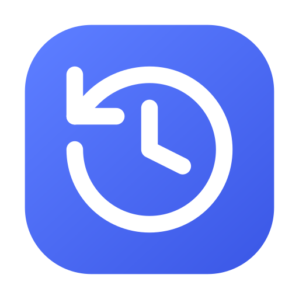
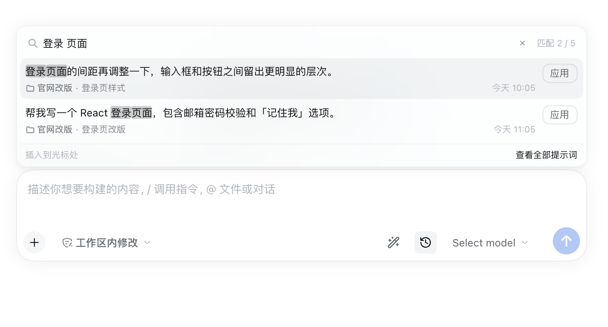

<p align="center"></p>

# Prompt Manage

[English](README.md) | [简体中文](README.zh.md)

[](https://www.npmjs.com/package/dsh-prompt-manage)
[](LICENSE)

Prompt Manage is a DeepSeek Harness plugin that helps you reuse prompts you
have already written and turn rough drafts into clearer prompts before sending
them.

## Features

- **Prompt palette.** Click the clock icon in the composer to search every
  prompt you have written. Search prompt text, project names, and session
  titles; separate words with spaces to require all of them. **Apply** inserts
  a prompt at the caret.
- **Prompt optimizer.** Click the magic-wand icon to rewrite the current draft
  with the model selected in the composer. **Undo** restores the original text.
- **Prompt Manage page.** Open it from the sidebar to browse every prompt with
  its project, session, and time. Copy any prompt with one click.

## Screenshots




## Installation

### From npm

```sh
dsh plugin --profile desktop add dsh-prompt-manage
```

### From a local checkout

In DeepSeek Harness, open **Plugins → Add plugin** and select the checkout
directory.

### Requirements

- DeepSeek Harness 0.2.2 or newer
- A Web or desktop profile

## Usage

### Reuse a prompt

1. Open a conversation and click the clock icon next to the model selector.
2. Search for a prompt, then click **Apply** or press Enter.
3. Edit the inserted text before sending.

If you search with multiple words, every word must match. For example,
`react 登录` finds prompts that mention both terms.

### Optimize a draft

1. Type or paste your draft in the composer.
2. Click the magic-wand icon.
3. Review the rewritten draft and press **Undo** if needed.

### Browse prompt history

Open **Prompt Manage** from the sidebar to see all saved prompts, or choose
**View all prompts** at the bottom of the composer palette. Each row shows the
prompt's project, session, and time; use **Copy** to copy it.

## Privacy

Prompt Manage reads local DSH session records only. Nothing is uploaded except
the draft you choose to optimize, which is sent to the model selected in your
composer in the same way as a normal message. The plugin never writes to your
session history.

## License

MIT. See [LICENSE](LICENSE). Icon geometry adapted from Lucide is covered in
[THIRD_PARTY_NOTICES.md](THIRD_PARTY_NOTICES.md).
