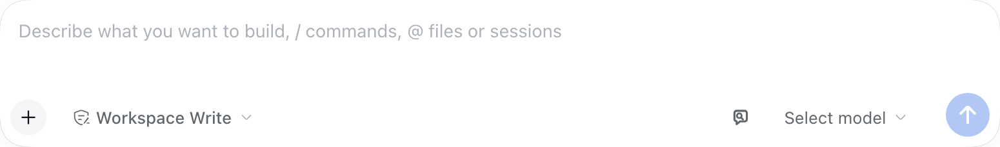
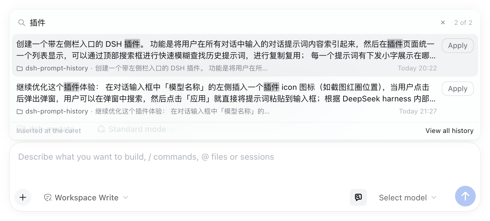

# Prompt history

A DeepSeek Harness bundle that makes the prompts you have already typed reusable
in two places:

- **A composer palette.** A small icon sits immediately left of the model name in
  the chat input. Clicking it opens a searchable palette right above the
  composer; **Apply** inserts that prompt into the input at the caret, ready to
  edit or send.
- **A sidebar page.** The **Prompt history** page indexes every prompt across
  workspaces and shows them in one searchable list with the owning project, the
  session title, and the input time. **Copy** puts the full prompt on the
  clipboard.





## Where to find it

- **Composer:** open any conversation (or the New Session composer). The prompt
  history icon is the chat-bubble-with-magnifier chip left of the model name. It
  opens a searchable palette; every row shows the prompt, its project, session,
  and time, and an **Apply** button. The footer's **View all history** opens the
  sidebar page.
- **Sidebar:** choose the prompt-history icon (the same bubble with a magnifier).
  The page is a normal main-panel entry, so it works without a session selected.

## Using the palette

- Typing in the palette searches prompt text, project names, and session titles
  with the same fuzzy matcher as the page; the newest prompts are listed first
  while the search box is empty.
- **Apply** (or clicking a row, or pressing Enter on the highlighted row) puts
  the prompt into the composer. With an empty composer the whole draft is
  replaced; with an existing draft the prompt is inserted at the caret and
  padded so it never glues onto neighbouring text.
- Up/Down walk the results, Escape closes the palette and returns focus to the
  composer, and clicking anywhere else closes it. While the composer is sending
  or running a command, Apply stays disabled and the footer says why.
- The palette reuses one 30-second cache of the local index: reopening is
  instant, and a failed refresh keeps the previous rows visible.

## How it works

- Host half: registers one local route, `GET /api/prompt-history`, and builds an
  in-memory index from `sessionQuery.listSessions()` + `sessionQuery.readSession()`.
  Only `user/message` events whose source kind is `user` are indexed, plus the
  objective of a `/goal` command (the Harness wraps that command instead of
  creating a plain user message). Time, runtime, approval, other command, and
  subagent-authored messages are excluded.
- Client half: registers `sidebar.panellist` with the matching `main` panel, then
  adds two composer contributions that share one seat: a compact chip in
  `conversation.input.right` (rendered directly before the model selector) and
  the palette in the composer's own `conversation.input.overlay` anchor, which
  positions it above the card at the composer's width. The palette never portaled
  into `document.body`, so it inherits the host theme, the composer's stacking
  context, and the docked layout.
- Insertion uses the session's published input actions: `setDraft` for an empty
  draft (so multi-line prompts become real paragraphs) and `insertText` at the
  caret captured when the chip was pressed otherwise. Focus returns through the
  conversation input facade, which restores the editor's stored selection.
- The chip and the palette are hand-written controls styled only with
  `--dsw-alias-*` / `--dsw-*` theme tokens; the bundle imports no Harness Client
  package, so host upgrades cannot break it.
- Cache: per-session persistence revisions avoid re-reading unchanged logs. The
  cache is memory-only; the session log remains the source of truth.

## Privacy and limits

Everything stays on the local machine. The route sits behind Connection's
Host/Origin and browser-authentication fence, and returns only prompt text,
project labels, session titles, and timestamps. It never uploads content or
writes to session logs. On macOS, the first copy can raise the system
clipboard/app-data permission prompt; allow it once to enable copying. Fork-inherited prompt prefixes are skipped so a forked
session does not duplicate its parent's history. Up to 5,000 prompts and 2,000
sessions are returned per request, with a 2,000,000-character response budget;
longer prompt text is truncated at 50,000 characters for display while the
source log is untouched. The palette renders at most 60 rows per search.

## Install

From npm:

```sh
dsh plugin --profile desktop add dsh-prompt-manage
```

Or install a local checkout with **Plugins → Add plugin**. Either way the bundle
must be listed in the profile's `dsh.profile.bundles`; the Plugins page adds
that row for you. Release notes live in [CHANGELOG.md](CHANGELOG.md) and the
publishing steps are in [RELEASING.md](RELEASING.md).

## Development

The bundle has no build step:

```sh
npm run check
npm test
```

When the bundle is linked from a profile, the Web client hot-reloads the changed
`client.js` (the host stat-polls each client bundle), so a page refresh is
normally unnecessary. The package is MIT licensed.
