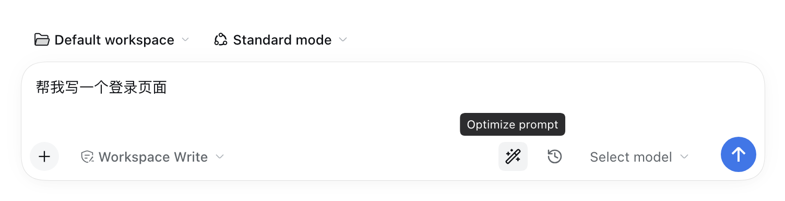

# Prompt Manage

A DeepSeek Harness bundle that makes the prompts you have already typed reusable,
and helps you turn a rough draft into a stronger prompt before sending it:

- **A prompt optimizer.** A magic-wand chip sits immediately left of the prompt
  icon (clock-with-rewind) in the chat input. When the input contains a raw prompt, clicking
  it sends that text to the **model currently selected for the session** with an
  editable system prompt, then replaces the draft with the optimized version.
- **A composer palette.** A small icon sits immediately left of the model name in
  the chat input. Clicking it opens a searchable palette right above the
  composer; **Apply** inserts that prompt into the input at the caret, ready to
  edit or send.
- **A sidebar page.** The **Prompt Manage** page indexes every prompt across
  workspaces and shows them in one searchable list with the owning project, the
  session title, and the input time. **Copy** puts the full prompt on the
  clipboard.



## Where to find it

- **Composer:** open any conversation (or the New Session composer). The prompt
  icon is the clock-with-rewind chip left of the model name. It
  opens a searchable palette; every row shows the prompt, its project, session,
  and time, and an **Apply** button. The footer's **View all prompts** opens the
  sidebar page. Immediately to its left is the wand **Optimize prompt** chip.
- **Sidebar:** choose the Prompt Manage icon (the same clock-with-rewind mark).
  The page is a normal main-panel entry, so it works without a session selected.

## Optimizing a prompt

1. Type or paste the raw prompt into the composer.
2. Click the wand chip. While the model works the chip shows a spinner.
3. The optimizer replaces the draft (when a slash command such as `/goal` or
   `/plan` opens the draft, only that command's argument text) with the content
   of the model's `<optimized_prompt>` block, keeping the command chip in place.
   A short **Prompt optimized and replaced** toast appears; **Undo** restores
   the original draft while it is still untouched.
4. Errors appear in the same place: no selected model, an unavailable model, a
   prompt that is too long, a timeout, or an unusable model answer.

The system prompt lives in [`prompts/prompt-optimizer.system.md`](prompts/prompt-optimizer.system.md).
It is sent verbatim on every request and is read from disk each time, so editing
that file and clicking the chip again uses your new wording without restarting
the app. The request uses the exact provider, model, and reasoning effort shown
in the composer's model selector; the current session's live Agent is asked for
that selection first, falling back to the selection snapshot in the browser and
then to the deployment default model.

## Using the palette


- Typing in the palette searches prompt text, project names, and session titles
  with the same fuzzy matcher as the page; the newest prompts are listed first
  while the search box is empty. Separate words with spaces to require all of
  them: `react 登录` matches only prompts that contain both terms, in either
  order; matching terms are highlighted when they fall inside the preview.
- **Apply** (or clicking a row, or pressing Enter on the highlighted row) puts
  the prompt into the composer. With an empty composer the whole draft is
  replaced; with an existing draft the prompt is inserted at the caret and
  padded so it never glues onto neighbouring text. If a slash command such as
  `/goal` or `/plan` is already active, the prompt is appended after that
  command and the command chip is preserved.
- Up/Down walk the results, Escape closes the palette and returns focus to the
  composer, and clicking anywhere else closes it. While the composer is sending
  or running a command, Apply stays disabled and the footer says why.
- The palette reuses one 30-second cache of the local index, revalidated with
  an ETag so an unchanged index costs a 304 instead of a re-download; reopening
  is instant, and a failed refresh keeps the previous rows visible. Its height is
  capped to the room above the composer and below the shell header, so the
  search row stays reachable in a short window; the footer yields to the result
  list when space is tight.

## How it works

- Host half: registers two local routes. `GET /api/prompt-history` builds an
  in-memory index from `sessionQuery.listSessions()` + `observeSession()` (with
  `readSession()` as a fallback). Only `user/message` events whose source kind is
  `user` are indexed, plus the objective of a `/goal` command (the Harness wraps
  that command instead of creating a plain user message). Time, runtime,
  approval, other command, and subagent-authored messages are excluded. The
  index is warmed once at activation. `POST /api/prompt-optimize` resolves
  the session's current model, reads `prompts/prompt-optimizer.system.md`,
  streams one auxiliary request through `ctx.llm.prepareCall()` with a
  180-second deadline, and returns only the parsed prompt plus notes. The
  request never enters the session log.
- Client half: registers `sidebar.panellist` with the matching `main` panel, then
  adds three composer contributions: the compact wand optimizer and clock-history
  chips in `conversation.input.right` (rendered directly before the model
  selector), and the palette in the composer's own
  `conversation.input.overlay` anchor, which positions it above the card at the
  composer's width. The palette never portaled into `document.body`, so it
  inherits the host theme, the composer's stacking context, and the docked
  layout.
- Insertion uses the session's published input actions: `setDraft` for an empty
  draft (so multi-line prompts become real paragraphs) and `insertText` at the
  caret captured when the chip was pressed otherwise. Focus returns through the
  conversation input facade, which restores the editor's stored selection.
- The chips and the palette are hand-written controls styled only with
  `--dsw-alias-*` / `--dsw-*` theme tokens; the bundle imports no Harness Client
  package, so host upgrades cannot break it.
- Cache: per-session persistence revisions avoid re-reading unchanged logs; the
  parsed per-session cache is bounded to 48 MB with LRU eviction. The response
  carries a stable ETag and is served stale-while-revalidate for up to 30
  seconds, so reopening costs one conditional request. The cache is memory-only;
  the session log remains the source of truth.

## Performance at scale

The index is designed for several thousand prompts without a perceptible pause:

- **Startup and refresh.** The background warm-up builds the first index at
  activation. Later scans list persistence revisions and re-read only sessions
  that changed; the parsed result for every unchanged session comes from the
  bounded in-memory cache.
- **Transfer.** A repeated request sends `If-None-Match` and receives a bodyless
  `304` when the index revision is unchanged. The server answers from its
  previous payload immediately after the 3-second freshness window and refreshes
  the cache in the background; an explicit refresh still waits for a fresh scan.
- **Search.** The client lowercases each prompt and its project/session labels
  once, not once per keystroke. Fuzzy fallback uses native `indexOf` over the
  full prompt only when a direct substring search misses.
  On a 5,000-entry synthetic index, preparing the search view is about 3 ms and
  a two-term query takes about 2 ms; the equivalent long-prompt workload is
  roughly an order of magnitude faster than the previous per-keystroke
  lowercasing and character loop. An end-to-end browser smoke test with 5,000
  synthetic prompts rendered its first 100 rows in about 110 ms and returned a
  two-word query in about 20 ms.
- **Rendering.** The page renders 100 rows first with a **Show more** button;
  `content-visibility: auto` lets the browser skip off-screen rows after that.
  The composer palette renders at most 60 rows.
- **Where it can go next.** For tens of thousands of prompts, the natural next
  step is pushing search into the host's SQLite FTS5 session index instead of
  shipping every prompt to the browser, plus true list virtualization and an
  opt-in disk cache of parsed sessions. Those are deliberately not enabled here:
  they add installation, privacy, and invalidation cost that is not justified
  until the local corpus reaches that scale.

## Privacy and limits

Everything stays on the local machine except the prompt optimizer's model call:
that call sends the draft you clicked the wand chip on to the provider route
selected in your composer, exactly as a normal message would. The Prompt
Manage route is read-only. It sits behind Connection's Host/Origin and browser-authentication
fence, and returns only prompt text, project labels, session titles, and
timestamps. It never uploads content or writes to session logs. On macOS, the
first copy can raise the system clipboard/app-data permission prompt; allow it
once to enable copying. Fork-inherited prompt prefixes are skipped so a forked
session does not duplicate its parent's history. Up to 10,000 prompts and 2,000
sessions are returned per request, with a 4,000,000-character response budget;
longer prompt text is truncated at 50,000 characters for display while the
source log is untouched. The palette renders at most 60 rows per search. The
prompt optimizer accepts up to 60,000 characters per request and does not modify
the session record.

## Install

From npm:

```sh
dsh plugin --profile desktop add dsh-prompt-manage
```

Or install a local checkout with **Plugins → Add plugin**. Either way the bundle
must be listed in the profile's `dsh.profile.bundles`; the Plugins page adds
that row for you. Release notes live in [CHANGELOG.md](CHANGELOG.md) and the
publishing steps are in [RELEASING.md](RELEASING.md).

## Development

The bundle has no build step:

```sh
npm run check
npm test
```

When the bundle is linked from a profile, the Web client hot-reloads the changed
`client.js` (the host stat-polls each client bundle), so a page refresh is
normally unnecessary. The package is MIT licensed; the composer icon geometry
is adapted from Lucide (ISC) and attributed in
[THIRD_PARTY_NOTICES.md](THIRD_PARTY_NOTICES.md).
