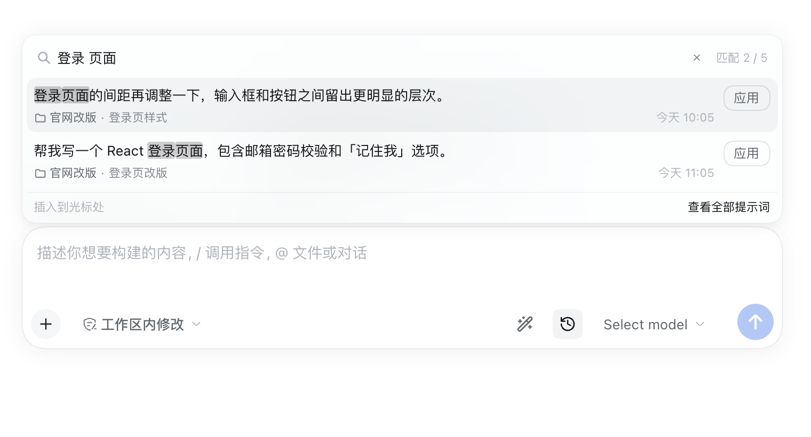
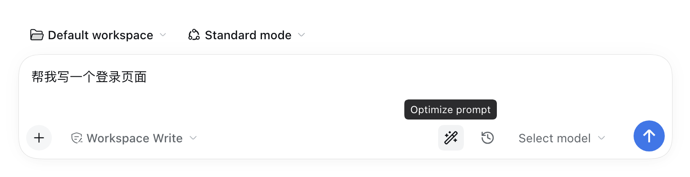

<p align="center"></p>

# 提示词管理

[English](README.md) | 简体中文

[](https://www.npmjs.com/package/dsh-prompt-manage)
[](LICENSE)

提示词管理是一个 DeepSeek Harness 插件，帮你复用已经写过的提示词，并在发送前把草稿改写成更清晰的提示词。

## 功能

- **提示词弹窗。** 在输入框点击时钟图标，搜索你写过的所有提示词。可以按提示词内容、项目名或会话标题搜索；多个关键词用空格分隔，必须同时匹配。点击「应用」即可把提示词插入光标处。
- **提示词优化。** 点击魔棒图标，用输入框当前选择的模型改写草稿；如果不满意，可以点击「撤销」恢复原文。
- **提示词管理页面。** 从侧边栏打开，查看全部提示词及其所属项目、会话和输入时间，并支持一键复制。

## 截图





## 安装

### 从 npm 安装

```sh
dsh plugin --profile desktop add dsh-prompt-manage
```

### 从本地目录安装

在 DeepSeek Harness 中打开 **插件 → 添加插件**，选择本地目录即可。

### 环境要求

- DeepSeek Harness 0.2.2 或更高版本
- Web 或桌面版 profile

## 使用

### 复用提示词

1. 打开任意对话，点击模型选择器旁边的时钟图标。
2. 搜索要用的提示词，点击「应用」或按 Enter。
3. 按需修改插入的文本后发送。

如果搜索多个词，所有词都必须匹配。例如 `react 登录` 会找到同时包含这两个词的提示词。

### 优化提示词

1. 在输入框中输入或粘贴草稿。
2. 点击魔棒图标。
3. 查看改写结果，如果不满意可以点击「撤销」恢复原文。

### 浏览提示词管理

从侧边栏打开 **提示词管理** 查看全部提示词，也可以在输入框弹窗底部点击「查看全部提示词」。每条记录都会显示所属项目、会话和输入时间，点击「复制」即可复制完整提示词。

## 隐私

提示词管理只读取本机 DSH 会话记录。除了你主动使用提示词优化时发送给当前所选模型的草稿外，不会上传任何内容；插件也不会写入你的会话历史。

## 许可证

MIT，详见 [LICENSE](LICENSE)。图标几何来自 Lucide（ISC 许可），说明见 [THIRD_PARTY_NOTICES.md](THIRD_PARTY_NOTICES.md)。
